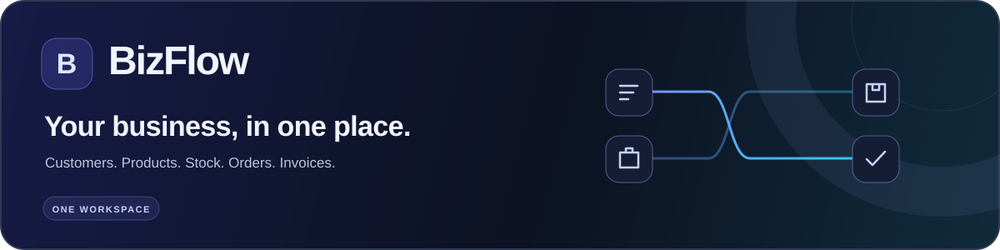
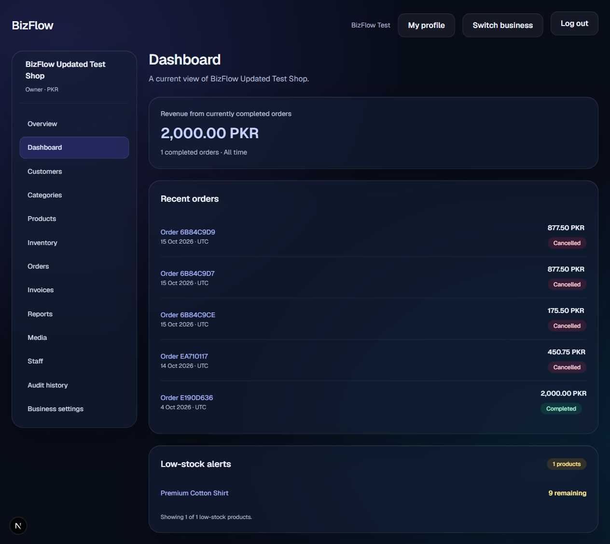
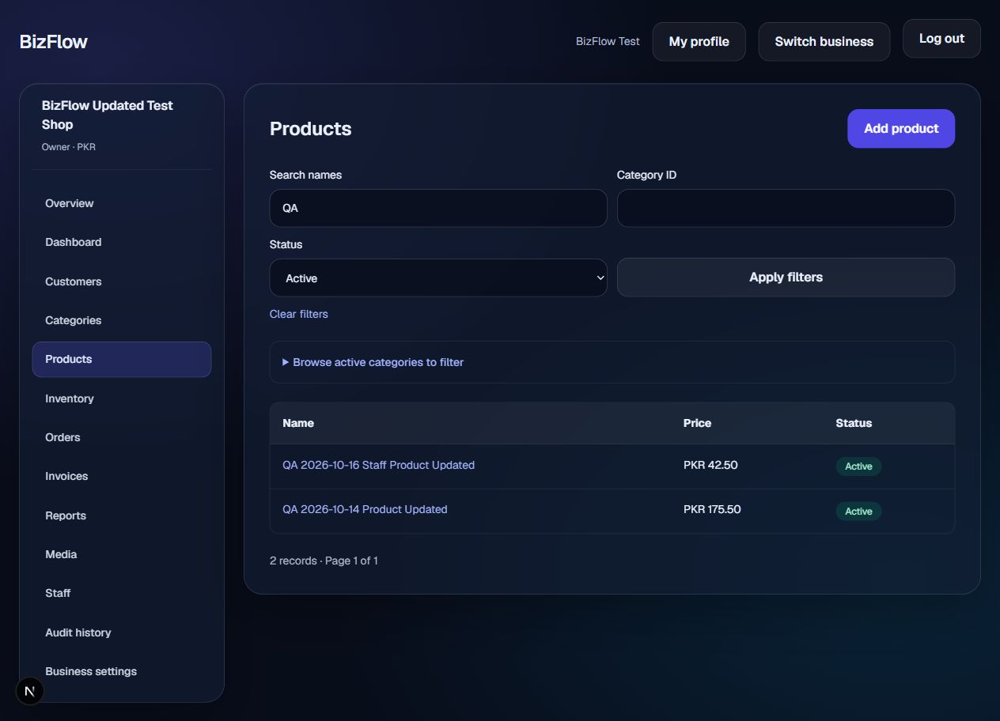
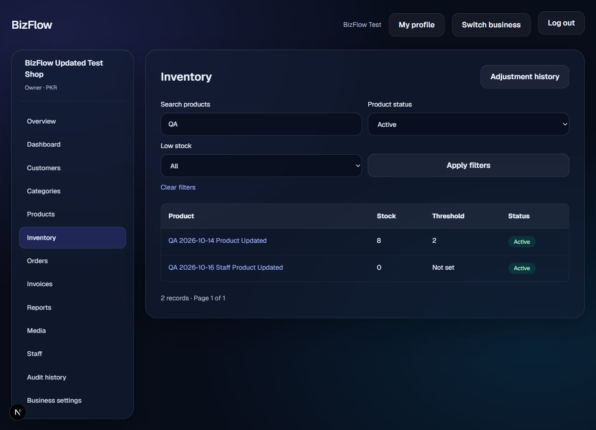
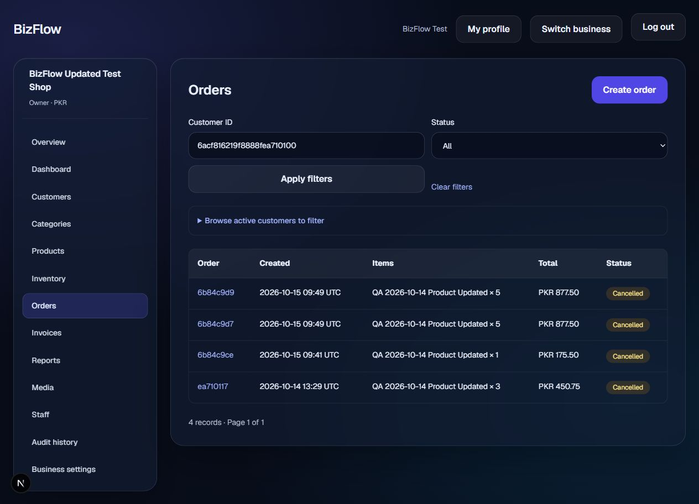
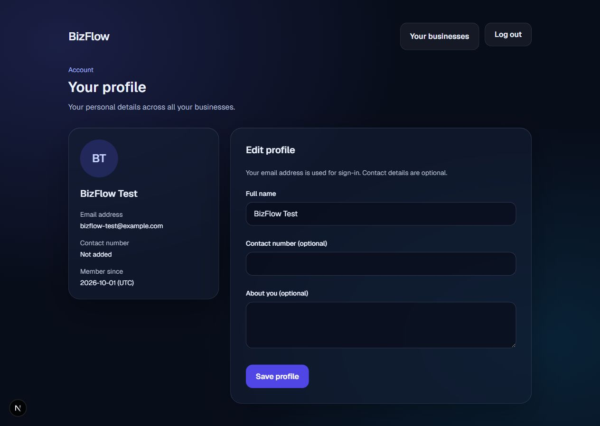

<div align="center">



**A full-stack workspace that connects everyday business operations.**

Customers, products, inventory, orders and invoices—across multiple businesses, with permissions for every team.

[**Open the live app ↗**](https://bizflow-kappa.vercel.app) · [Screenshots](#a-look-inside) · [Run locally](#run-locally) · [Project specification](PROJECT.md)


</div>

---

## Built around the way a business works

BizFlow brings the catalog, customer records and order lifecycle into one application. Owners can switch between businesses, give staff specific permissions, and follow changes through an audit history. Completing an order connects stock movement and invoice creation in a database transaction.

| Business essentials | Team and account tools |
| --- | --- |
| Customers with purchase history | Multiple businesses under one account |
| Categories, products and image assignments | Owner and configurable staff permissions |
| Stock adjustments and low-stock thresholds | Staff invitations and access revocation |
| Orders with completion and cancellation flows | Account profile with name, contact and bio |
| Automatic invoices with printable HTML | Session-based authentication and recovery flow |
| Dashboard, reports and audit history | Responsive forms and keyboard-friendly confirmations |

## A look inside

Five genuine application screenshots captured from the local QA workspace. The visible records are demonstration/QA data, not a public production account. Click an image to view it at full size.

### The business at a glance

[](docs/screenshots/dashboard.jpg)

<table>
  <tr>
    <td width="50%" valign="top">
      <h3>Product catalog</h3>
      <a href="docs/screenshots/products.jpg"></a>
      <p>Find products, filter the catalog and open product details.</p>
    </td>
    <td width="50%" valign="top">
      <h3>Inventory control</h3>
      <a href="docs/screenshots/inventory.jpg"></a>
      <p>Track quantities, thresholds and adjustment history.</p>
    </td>
  </tr>
  <tr>
    <td width="50%" valign="top">
      <h3>Order management</h3>
      <a href="docs/screenshots/orders.jpg"></a>
      <p>Follow order status, customer references and totals.</p>
    </td>
    <td width="50%" valign="top">
      <h3>A profile of your own</h3>
      <a href="docs/screenshots/profile.jpg"></a>
      <p>Manage your name, contact number and short bio.</p>
    </td>
  </tr>
</table>

## What happens when an order moves?

1. **Create:** choose a customer and products. The order stores item and price snapshots.
2. **Complete:** check availability, deduct stock, issue an invoice and write audit events atomically.
3. **Cancel:** apply the permitted transition; a completed order reverses its stock movement and voids its invoice.
4. **Review:** browse the invoice, stock history, reports and audit trail.

Historical order and invoice prices remain separate from later catalog edits. Business queries are scoped to verified membership, and staff permissions are checked on the server.

## Under the hood

| Layer | Technology |
| --- | --- |
| Application | Next.js 16 App Router, React 19, TypeScript |
| Interface | Tailwind CSS 4, responsive glass-style components |
| Data | MongoDB, Mongoose 9, multi-document transactions |
| Validation and calculations | Zod 4, Decimal.js |
| Authentication | HTTP-only session cookies, hashed session/reset tokens, bcryptjs |
| Media | Cloudinary, Sharp image validation and processing |
| Email | Nodemailer with provider-configured TLS |
| Hosting | Vercel |

```text
src/app/          Pages, layouts and API route handlers
src/components/   Authentication and business workspace UI
src/services/     Business logic, authorization and transactions
src/models/       Mongoose schemas and indexes
src/lib/          Validation, database, authentication and integrations
tests/            Offline, public HTTP and isolated database tests
scripts/          Connection diagnosis and guarded QA fixture recovery
docs/             README artwork and application screenshots
```

## Run locally

### 1. Get the project

Requirements: **Node.js 20.19+**, npm, and a MongoDB replica set/Atlas deployment with transaction support. Cloudinary is needed for images; SMTP is needed for invitations and recovery emails.

```bash
git clone https://github.com/salih-x-tech/bizflow.git
cd bizflow
npm ci
```

### 2. Configure the development environment

Copy the blank template to `.env.local`. In PowerShell:

```powershell
Copy-Item .env.example .env.local
```

Fill the values privately:

| Variable | Used for |
| --- | --- |
| `APP_URL` | Exact app origin; locally `http://localhost:3000` |
| `MONGODB_URI` | Development MongoDB connection |
| `CLOUDINARY_CLOUD_NAME` | Media cloud name |
| `CLOUDINARY_API_KEY`, `CLOUDINARY_API_SECRET` | Server-side media authentication |
| `SMTP_HOST`, `SMTP_PORT`, `SMTP_SECURE` | Mail server and matching TLS settings |
| `SMTP_USER`, `SMTP_PASS` | SMTP authentication |
| `EMAIL_FROM` | Provider-authorized sender |

The app explicitly uses database **`bizflow`**. Use a development cluster/connection for local work, and keep `.env.local` out of Git. The committed `.env.example` contains no credentials.

### 3. Start the app

```bash
npm run dev
```

Open **[localhost:3000](http://localhost:3000)**. If you use another port, update `APP_URL` to match it.

For a fresh development database, this development-only endpoint creates collections and indexes without seeding accounts:

```powershell
Invoke-RestMethod -Uri http://localhost:3000/api/dev/db-setup -Method Post
```

Register your own account through the application. Development setup endpoints are disabled in production.

## Quality and verification

```bash
npm test
npx eslint .
npm run build
npx tsc --noEmit
```

The build uses webpack through the package script. Run the build before the standalone TypeScript check so generated route types are available.

| Most recent recorded check | Result |
| --- | --- |
| Offline service/security suite | 32 passing Node test results |
| Isolated real MongoDB integration suite | 29 passing Node test results |
| Public HTTP security checks | 47 endpoint cases passed, including on the live deployment |
| Production build, TypeScript and ESLint | Passed |

These are recorded results, not a claim that every production workflow has been signed off. Coverage, evidence and remaining manual checks are documented in **[QA-RESULTS.md](QA-RESULTS.md)**.

<details>
<summary><strong>More test and diagnostic commands</strong></summary>

Read-only MongoDB diagnosis, with connection details hidden:

```bash
node scripts/check-mongodb.cjs
```

Against an already-running local server, in PowerShell:

```powershell
$env:BIZFLOW_QA_BASE_URL = 'http://localhost:3000'
npm run test:api
```

Real database integration requires explicit opt-in and disposable-fixture authorization. It uses a newly generated isolated QA database, sends no emails and makes no Cloudinary requests. Read **[TESTING.md](TESTING.md)** before running it.

</details>

## Deployment and documentation

The live app is hosted at **[bizflow-kappa.vercel.app](https://bizflow-kappa.vercel.app)**. It requires your own account; shared demo credentials are not published.

| Read this | For |
| --- | --- |
| [Project specification](PROJECT.md) | Requirements, data model and implementation phases |
| [UI handoff](UI-HANDOFF.md) | Implemented screens and workflow notes |
| [Testing guide](TESTING.md) | Commands, boundaries and isolated fixture handling |
| [QA results](QA-RESULTS.md) | Observed behavior, evidence and remaining checks |
| [Deployment guide](DEPLOYMENT.md) | Vercel setup, production configuration and acceptance |

## Meet the developer

Built by **Salih Hayat**.

<a href="https://github.com/salih-x-tech"></a>
<a href="https://www.linkedin.com/in/salih-hayat-dev/"></a>
<a href="https://www.instagram.com/salihxtech/"></a>

---

<div align="center">
  <strong>Less switching. More clarity.</strong><br />
  <sub>BizFlow · Your business, in one place.</sub>
</div>
